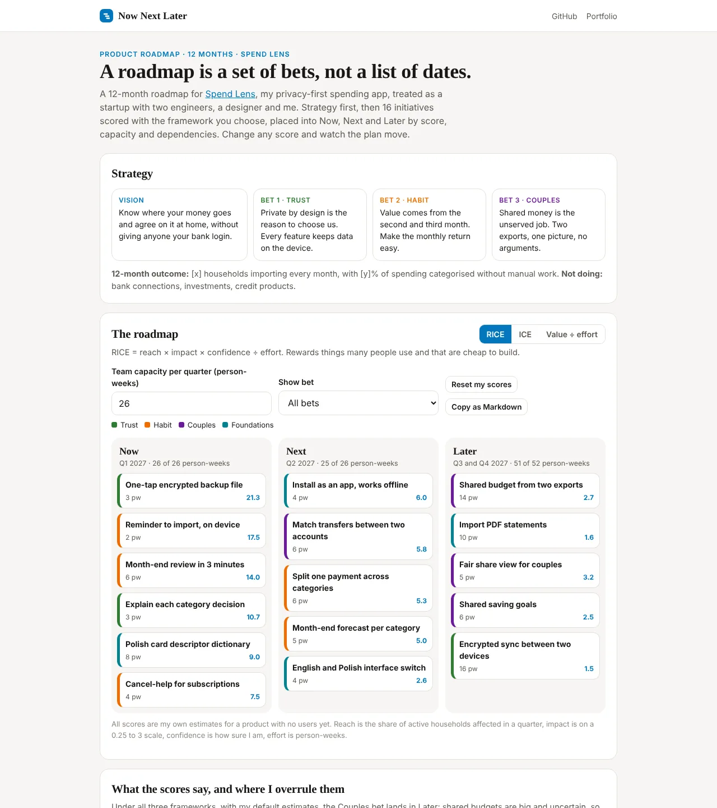

# Now Next Later

**A 12-month roadmap for Spend Lens: strategy, 16 scored initiatives, capacity, dependencies and a quarter plan that moves when you change a score.**

**Current version:** 0.1.0

Live: https://kostasxeras.com/now-next-later/



## The question

Roadmaps in portfolios are usually a static picture of boxes and dates. A real roadmap is a set of bets under constraints: a strategy, limited capacity, dependencies, and scores that are only estimates. I wanted a roadmap where those constraints are live, using my own app Spend Lens as the startup, so a reader can see how the plan changes and where judgement overrules the numbers.

## Who it is for

- Hiring managers who want to see how I build and defend a roadmap
- Product managers who want a small, honest prioritisation tool

## What is inside

- **Strategy**: vision, three bets (Trust, Habit, Couples), a 12-month outcome with placeholders and a not-doing list
- **16 initiatives** each with problem, the metric it should move, reach, impact, confidence, effort and dependencies
- **Three scoring frameworks**: RICE, ICE and value divided by effort, with a note on what each one rewards
- **Automatic Now, Next and Later** by score, team capacity and dependencies
- **Editor** with sliders and pinning, and warnings when a pinned item comes before what it depends on
- **Quarter plan** with capacity used per quarter
- **Copy as Markdown** and settings saved in the browser

## Main findings

Full detail in the [case study](docs/case-study.md).

- **Scoring pushes the strategic bet to Later** (from my own estimates). Under RICE, ICE and value divided by effort, with my default estimates and 26 person-weeks a quarter, shared budgets for couples land in Q3 or Q4. Cheap, certain habit work fills Q1. I would pin shared budgets to Next and run interviews first to raise its confidence or drop it.

## Data and sources

No real data. Spend Lens has no users yet, so every reach, impact, confidence and effort value is my estimate and is labelled as such. The 12-month outcome uses [placeholders].

## Decisions

- [Now, Next, Later instead of dates](docs/decisions/0001-now-next-later.md)
- [Three scoring frameworks side by side](docs/decisions/0002-three-frameworks.md)
- [Capacity and dependencies decide the quarter](docs/decisions/0003-capacity-and-deps.md)
- [Write down where I overrule the score](docs/decisions/0004-judgement-over-score.md)

## How I would measure success

These are the outcome measures the roadmap is built to move.

| Measure | Definition | Target |
|---|---|---|
| Monthly importing households | Households importing every month | [x] |
| Auto-categorised share | Share of spending categorised without manual work | [y]% |
| Second-month return | Share of new users importing a second month | [target] |

## What I would do next

1. Replace estimates with data after Spend Lens has [n] users
2. Add confidence ranges and show which items change horizon
3. Link each initiative to a one-page brief

## How it was built

I framed the problem, made the product calls and wrote the conclusions. Claude (Anthropic) was my engineering partner for the code. 

## Run it yourself

One HTML page with no build step. Open `index.html` through any local web server, for example `python3 -m http.server`, then go to http://localhost:8000.

## Repo layout

```
index.html               The page
app.css                  Shared base styles
docs/product-brief.md    Problem, users, goals, scope
docs/case-study.md       Approach, decisions, findings, next steps
docs/decisions/          One record per real tradeoff
docs/screenshots/        Desktop and mobile
```
